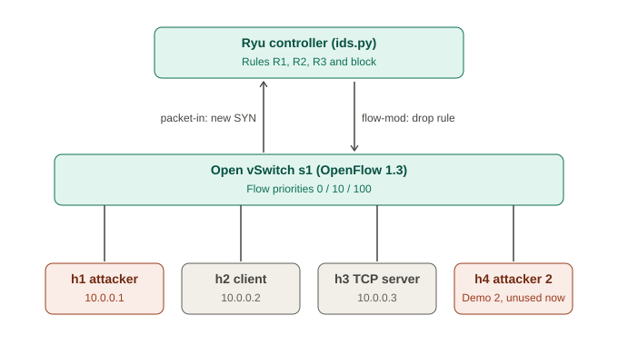

# SDN-Based Network Intrusion Detection and Response

**SDN-Socket Programming, Jackfruit Mini Project (Demo 1)**
Topic 25: Network Intrusion Detection and Response

A multi-client TCP service runs on a Mininet network controlled by a Ryu (OpenFlow 1.3) controller.
The controller observes new TCP connections, applies sliding-window detection rules, and
**dynamically installs drop rules on the switch** to block abusive sources. Detection and response
times are measured and compared with a static switch (IDS off).

> Author: `<your name, SRN>`  |  Course: `<course / section>`  |  Demo 1 scope: detection rules R1-R3, blocking, baseline comparison

## Features

* Low-level **TCP socket** application: line protocol, worker-thread pool, bounded queue (load shedding), idle timeouts, error handling
* **Mininet** topology: 1 OpenFlow 1.3 switch, 4 hosts, remote Ryu controller
* **SDN controller** (`controller/ids.py`): learning switch, per-connection flows, flow-statistics polling
* **Intrusion detection rules**: R1 connection rate, R2 port scan, R3 many tiny flows
* **Dynamic response**: priority-100 drop flow with a hard timeout, automatic unblock
* **Controlled attack traffic**: scan and connection flood generators (isolated lab use only)
* **Measurements**: detection time, response time, end-to-end time, legitimate-client success and latency, controller packet-in count
* **Baseline**: the same attacks against the same controller with `IDS_MODE=off`

## Architecture



1. A host opens a TCP connection; the switch has no flow for it, so the first packet goes to the controller (**packet-in**).
2. The controller counts new connections (SYN without ACK, destined to the server) per source in a 5 s sliding window and checks the rules.
3. When a rule fires, the controller sends a **flow-mod**: a priority-100 rule that drops all IP traffic from the source for 60 s.

| Flow priority | Purpose |
|---|---|
| 0 | Table-miss: send to controller |
| 10 | Per-connection forwarding, idle timeout 5 s (so each *new* connection reaches the controller) |
| 100 | Block rule: match source IP, no actions = drop, hard timeout 60 s |

More detail: [docs/design.md](docs/design.md).

## Detection rules (defaults, overridable by environment variables)

| Rule | Condition | Default |
|---|---|---|
| R1 high connection rate | new connections from one source to the server in `WINDOW` | > 30 in 5 s |
| R2 port scan | distinct destination ports from one source in `WINDOW` | > 10 in 5 s |
| R3 many tiny flows | flows with at most 2 packets from one source in one stats poll | > 15 |

Variables: `IDS_MODE` (`on`/`off`), `SERVER_IP`, `WINDOW`, `RATE_LIMIT`, `PORT_LIMIT`, `SHORT_FLOWS`, `BLOCK_TIME`, `POLL_EVERY`.

## Requirements

Verified on an Ubuntu 26.04 VM: Mininet 2.3.0, Open vSwitch 3.7.1, Ryu 4.34 in a Python 3.9 virtualenv.
Ryu is old and does not run on current system Python versions, so it gets its own Python 3.9 environment.
Step-by-step instructions: [docs/SETUP.md](docs/SETUP.md).

## Quick start

```bash
git clone <your-repo-url> sdn-ids && cd sdn-ids
scripts/run.sh normal          # legitimate client only (expect no block)
scripts/run.sh scan            # port scan, IDS on
scripts/run.sh flood           # connection flood, IDS on
scripts/run.sh scan off        # baseline: same attack, no IDS
scripts/run.sh flood off
```

`scripts/run.sh` does the steps in the required order: `mn -c`, start Ryu, wait for port 6653, run the demo, stop Ryu.
Set `RYU_VENV` if your virtualenv is not at `~/ryuenv`.
Output files are written to `results/` (`detections.csv`, `flowstats.csv`, client/attack logs, `ryu_*.log`).

## Manual run (two terminals)

**Order matters: `sudo mn -c` kills any running `ryu-manager`, so run it first.**

```bash
# Terminal B (no venv)
cd sdn-ids && sudo mn -c

# Terminal A (venv active)
source ~/ryuenv/bin/activate && cd sdn-ids
ryu-manager --ofp-tcp-listen-port 6653 controller/ids.py

# Terminal B, after Ryu prints "instantiating app"
sudo python3 topology/topo.py --demo scan        # normal | scan | flood
sudo python3 topology/topo.py                    # or an interactive Mininet CLI
```

Interactive checks inside the Mininet CLI:

```
mininet> h3 python3 app/app_server.py > results/server.log 2>&1 &
mininet> pingall
mininet> h2 python3 app/app_client.py 10.0.0.3 5 0.5
mininet> h1 python3 app/attack.py scan 10.0.0.3 --duration 10
mininet> sh ovs-ofctl -O OpenFlow13 dump-flows s1
mininet> h1 ping -c 2 10.0.0.3                    # fails while h1 is blocked
```

## Results (measured on the VM, one run per case)

| Metric | Static switch (IDS off) | SDN-IDS (on) |
|---|---|---|
| Scan: probes the attacker sent in 10 s | 500 | 41 |
| Flood: connections that succeeded in 10 s | 1000 of 1000 | 30 of 61 |
| Attacker can reach server after attack | yes (ping 0% loss) | no (100% loss, drop rule installed) |
| Detection time, scan / flood | n/a | 214.4 ms / 296.2 ms |
| Response time (rule fires to flow-mod sent) | n/a | 0.12 ms / 0.13 ms |
| End-to-end, scan / flood | n/a | 219.5 ms / 302.3 ms |
| Legitimate client success during attack | 100% | 100% |
| False positives (normal run) | n/a | 0 |

The attacks used here do not overload the server, so the legitimate client succeeds in both modes. The benefit shown
is containment of the attacker and far fewer packets reaching the server. Server-overload scenarios are planned for Demo 2.
Full table, interpretation and caveats: [docs/results.md](docs/results.md). Test cases: [docs/test_cases.md](docs/test_cases.md).

## Repository structure

```
controller/ids.py        Ryu app: learning switch, detection rules, blocking, flow stats
app/app_server.py        multi-client TCP server (worker pool, bounded queue, timeouts)
app/app_client.py        legitimate client (logs latency and success)
app/attack.py            controlled scan / flood generator (lab use only)
topology/topo.py         Mininet topology and automated demo (--demo normal|scan|flood)
scripts/run.sh           one-command runner in the correct order
scripts/summarize.py     computes the metrics from the logs
docs/                    design, setup, results, test cases, viva notes, screenshots
results/                 CSV and log output from runs
requirements.txt         Python packages for the controller virtualenv
```

## Metrics: how they are measured

* **Detection time**: first SYN in the sliding window until the rule fires (controller clock).
* **Response time**: rule fires until the drop flow-mod is sent to the switch.
* **End-to-end**: attack start (logged by `attack.py`) until the drop flow-mod is sent.
* **Probes OK after block**: successful attacker probes after the block time; should be 0.
* All Mininet hosts and the controller share the VM clock, so timestamps are directly comparable.

## Troubleshooting

| Symptom | Cause and fix |
|---|---|
| `pingall` shows 100% dropped; "Unable to contact the remote controller" | Ryu is not running. `sudo mn -c` kills it, so run `mn -c` first, then start Ryu. Use `scripts/run.sh`. |
| `ryu-manager: command not found` | The virtualenv is not active: `source ~/ryuenv/bin/activate`. |
| `Failed to build ryu` / `get_script_args` | Old build tools needed, see [docs/SETUP.md](docs/SETUP.md). |
| `TypeError: get expected at least 1 argument` in Ryu's `app_manager.py` | An app attribute named `self.events` shadows Ryu's internal queue. Fixed in this repo (`self.syn_log`). |
| `unsupported version 0x3` flood in Ryu output | A switch is speaking an older OpenFlow version; clean up with `sudo mn -c` and restart. |
| Stale state between runs | Stop Ryu, `sudo mn -c`, restart Ryu, then start the topology. |

## Limitations and future work (Demo 2)

* Threshold rules only, no learning; thresholds chosen from the measured normal-client rate (see design notes)
* Single switch; spoofed source IPs would block the wrong address; the controller sees the first packet of each connection only
* Demo 2: application-to-controller UDP alerts (malformed requests, idle timeouts, overload), slow-connection attack,
  two simultaneous attackers, bursty legitimate client (false-positive trade-off), more runs per scenario with graphs

## Ethical use

The scan and flood generators are for the isolated Mininet lab network of this project only. Do not run them against
systems you do not own or have permission to test.
